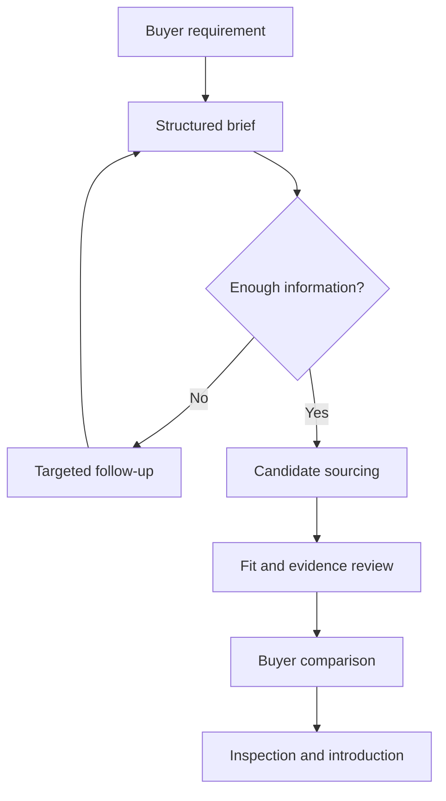

# From equipment request to reviewable next action

[Back to case study](../README.md)

## Workflow

Buyer and seller retain authority over their transaction. The operating workflow supports sourcing and coordination.

## Information that changes the result

| Input | Why it matters |
| --- | --- |
| Machine capability and application | Prevents recommending equipment that cannot perform the intended work. |
| Budget and installed-cost assumptions | Makes equipment, transport, rigging, and other known costs comparable. |
| Location and timing | Changes which candidates can be inspected and delivered in time. |
| Condition and operating evidence | Separates a listing claim from a verified inspection finding. |
| Required versus preferred features | Avoids filtering out useful alternatives or weakening a genuine requirement. |

## Integration and reliability

- The intake implementation uses the intended Workspace identity and message identifiers.
- Duplicate detection protects against processing the same event repeatedly.
- Controlled test messages are distinguished from genuine customer requirements.
- Operational history is append-oriented so corrections remain traceable.
- Reporting distinguishes a sent message, reply, qualified requirement, introduction, transaction, and revenue.
- Recovery behavior uses bounded retries and records unresolved conditions.

## Acceptance approach

The historical project checked authentication/transport, sender and reply routing, parsing, duplicate handling, internal state, recovery, and website behavior. Broader Python verification was recorded in August 2026.

This public case study summarizes those records. It does not publish private evidence or assert that a fresh end-to-end production test occurred during this portfolio update.
